# rawdatafilelibs: design and reference

Format-independent reading and writing of DUNE DAQ raw data files (files of TriggerRecords or
TimeSlices), with the on-disk format supplied by a backend plugin.

This document describes the code as it is, for developers who review or use the package. It covers:

| Repository | Branch | Commit | What is covered |
|---|---|---|---|
| rawdatafilelibs | `wketchum/rdf-06-python` | `eba8f5d` | everything (rdf-04 core, at `0a0bf65`, plus rdf-06 Python) |
| hdf5libs | `wketchum/rdf-09-hdf5libs-deprecated` | `0115492` | the HDF5 backend, as the worked example of a backend (rdf-05 at `879965f`) |
| dfmodules | `wketchum/rdf-07b-geoid-map` | `a3ff1b9` | `FileDataStore`, briefly |
| daqdataformats | `wketchum/rdf-03-record-index` | `b78ddbd` | `RecordID`, `RecordIndex`, `SourceIDSelector`, `SourceIDGeoIDMap`, as far as rawdatafilelibs uses them |
| detdataformats | `wketchum/rdf-02-geoid` | `2578423` | `GeoID` |

Paths without a repository name are relative to the rawdatafilelibs repository, for example
`include/rawdatafilelibs/RawDataFileReader.hpp`. Paths in other repositories are written as
`hdf5libs:src/HDF5Backend.cpp`.

The overview of the refactor as a whole, the design of the dfmodules FileDataStore, and the PR
descriptions of every step (rdf-01 to rdf-09) are in the Google Drive folder
<https://drive.google.com/drive/folders/1zu3Tt-tLmb9ePW-DEjJNUFND69wTVBkF>. This document does not
depend on them.

---

## Contents

1. [Purpose, scope and place in the stack](#1-purpose-scope-and-place-in-the-stack)
2. [Design principles](#2-design-principles)
3. [Package contents](#3-package-contents)
4. [Class diagrams](#4-class-diagrams)
5. [Reading](#5-reading)
6. [Writing and the file lifecycle](#6-writing-and-the-file-lifecycle)
7. [Recovery of unfinished files](#7-recovery-of-unfinished-files)
8. [Error model](#8-error-model)
9. [File utilities](#9-file-utilities)
10. [Python API](#10-python-api)
11. [The HDF5 backend (worked example)](#11-the-hdf5-backend-worked-example)
12. [The main writer client: dfmodules FileDataStore](#12-the-main-writer-client-dfmodules-filedatastore)
13. [Adding a new format backend](#13-adding-a-new-format-backend)
14. [Testing](#14-testing)
15. [Known limitations and open points](#15-known-limitations-and-open-points)

---

## 1. Purpose, scope and place in the stack

Before the refactor, `hdf5libs::HDF5RawDataFile` did three jobs at once: it held the record model
(which SourceIDs, fragment types, subdetectors and GeoIDs a record contains), did generic file
handling (metadata, record assembly, the in-progress name, errors), and did HDF5 storage (groups,
datasets, attributes). rawdatafilelibs takes over the generic file handling and does it once for
every format. A format provides only a small storage interface, a `ReaderBackend` and a
`WriterBackend`.

**In scope**
- `RawDataFileReader` and `RawDataFileWriter`, the format-independent reader and writer.
- The backend interfaces and the plugin mechanism that finds a backend from the file name.
- `FileMetadata`, `FileStats` and `RecordType`, the file-level metadata common to all formats.
- Recovery of files left unfinished, as a library function (`recover_raw_data_file`) and as the
  application `rawdatafile_recover`.
- File utilities for DAQ writers: file names, the timestamp suffix, free space, and a rename that
  never replaces a file.
- An in-memory test double for unit tests, loadable in a work area as the test plugin `rdfmem`. It is
  not a file format.
- Python bindings that mirror the C++ API, plus a Pythonic layer.

**Out of scope**
- The on-disk format. HDF5 lives in hdf5libs as the `hdf5` plugin.
- The record model types, which live in daqdataformats and detdataformats.
- DataStore logic such as rollover, retries and opmon. That lives in dfmodules' `FileDataStore`.

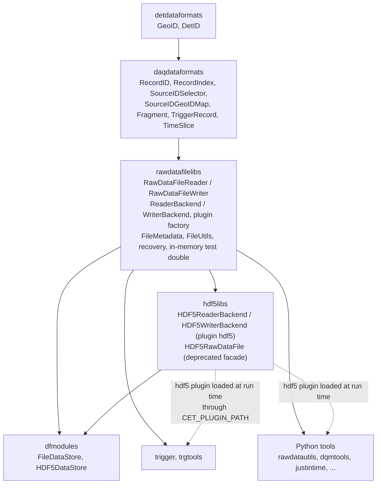

Solid arrows mean "is built on" (a compile-time dependency, pointing from the lower layer to its
user). Dashed arrows show the backend plugin being loaded at run time. Code that only uses the
generic API, such as trigger or the Python tools, needs hdf5libs only at run time, for the plugin. dfmodules' `HDF5DataStore` includes `hdf5libs/HDF5Backend.hpp` directly,
because it constructs the backend itself (§12).

rawdatafilelibs links cetlib, cetlib_except, ers, daqdataformats and detdataformats
(`CMakeLists.txt`). It must come after daqdataformats and before hdf5libs in the build order.

---

## 2. Design principles

**1. The record index is the source of truth.** Every record has a `daqdataformats::RecordIndex`
that lists its header SourceID and, for each fragment, its SourceID with fragment type and
subdetector. The writer builds the index from the record itself (`RecordIndex::from(...)` in
`src/RawDataFileWriter.cpp`), and the backend stores it. The reader answers every question about a
record from its index:
- a SourceID that isn't in the index gives `SourceIDNotFound`;
- a SourceID that is in the index but whose bytes can't be read gives `RecordPartUnreadable`;
- selections (`SourceIDSelector`) and per-record GeoIDs are worked out from the index.

See `include/rawdatafilelibs/RawDataFileReader.hpp` (class comment) and
`src/RawDataFileReader.cpp`.

**2. No dataset paths in the generic API.** A fragment is addressed by (RecordID, SourceID), and
nothing else. The backend interface moves bytes keyed the same way: `read_blob(record_id,
source_id)`, plus `write_record(index, header, fragments)`, where each `BlobView` carries its
SourceID. Format-specific locations, such as HDF5 dataset paths, are expert extras on the concrete
backend class. Callers reach them through `get_backend()` and a cast (`RawDataFileReader.hpp`:
"For format-specific extras, e.g. `dynamic_cast<hdf5libs::HDF5ReaderBackend&>(reader.get_backend())`").

**3. `.writing` and never-replace live in the generic writer.** `RawDataFileWriter` does both for
every format (`src/RawDataFileWriter.cpp`):
- The file is created as `<name>` + in-progress suffix, by default `".writing"`
  (`RawDataFileWriter::s_default_inprogress_suffix`). `close()` renames it to `<name>`.
- If either name already exists, construction fails with `FileOpenFailed`, and the existing file
  is left untouched.
- The backend's `open()` must itself fail if the path exists. HDF5 uses `HighFive::File::Excl`.
- The final rename goes through `WriterBackend::rename_path`, which must never replace an
  existing file. The default uses `rename_without_replacing()` (renameat2 `RENAME_NOREPLACE`, or
  `link()` + `unlink()`).
- If the final name has appeared by the time of `close()`, close fails and the file keeps its
  in-progress name.

**4. Backends are cetlib plugins, chosen by file extension.** A backend is a shared library of
cetlib plugin type `duneRawDataFileBackend`. It exports `make_reader()` and `make_writer()`, both
declared by `DEFINE_DUNE_RAW_DATA_FILE_BACKEND(reader_klass, writer_klass)`
(`include/rawdatafilelibs/Backend.hpp`). The plugin's name is the file extension that it handles.
`backend_name_from_path()` (`src/BackendFactory.cpp`) applies these rules:
1. Take the file name only, without the directory.
2. Remove trailing known suffixes, in any order and as long as one matches: the in-progress
   suffix (default `.writing`) and `.copied`, the suffix that the file transfer system adds. A
   suffix is removed only if something comes before it.
3. The backend name is what follows the last `.`. It is empty if there is no dot, the dot is the
   first character (a hidden file), or the dot is the last character.

So `run1.hdf5`, `run1.hdf5.writing`, `run1.hdf5.copied`, `run1.hdf5.writing.copied` and
`run1.hdf5.copied.writing` all give `hdf5`, and `run1.v2.rdfmem`
gives `rdfmem`. An empty name, or a name with no plugin, gives `BackendNotAvailable`. For any
other file name, pass the backend name explicitly. Every entry point takes an optional
`backend_name` that overrides the extension.

**5. Buffers are malloc'd so that a Fragment can adopt them.** `ReaderBackend::read_blob()` returns
a `Blob`, which is a `std::unique_ptr<char[], FreeDeleter>` plus a size. It is allocated with
`std::malloc` by `allocate_blob()`, which always allocates at least 1 byte so that the pointer is
never null. The reader passes `buffer.data.release()` to
`Fragment(..., BufferAdoptionMode::kTakeOverBuffer)`, and `Fragment` frees it with `std::free`. No
copy is made, and allocation and deallocation match. Before the refactor, hdf5libs handed `new[]`
memory to `Fragment`, which then freed it with `std::free`.

**6. Thin backends.** Backends only store and retrieve bytes, record indices and metadata. The
generic layer does the rest: record assembly, index caching, record-type and duplicate checks,
error translation into ERS issues, closing values, the in-progress name, removing a failed
record, and recovery bookkeeping (`Backend.hpp` file comment).

**7. Explicit, checked close.** `close()` reports failures. Destructors call `close()` but only
log failures, with `ers::error`, and never throw. A close is attempted once and is never retried
(§6, §8).

---

## 3. Package contents

| File | Contents |
|---|---|
| `include/rawdatafilelibs/Backend.hpp`, `src/Backend.cpp` | `ReaderBackend`, `WriterBackend`, `RecoveryScan`, `Blob`, `BlobView`, `FreeDeleter`, `allocate_blob()`, `DEFINE_DUNE_RAW_DATA_FILE_BACKEND`; defaults for `discard_record`, `path_exists`, `rename_path` and the recovery hooks |
| `include/rawdatafilelibs/BackendFactory.hpp`, `src/BackendFactory.cpp` | `backend_name_from_path()`, `make_reader_backend()`, `make_writer_backend()`, `open_raw_data_file()`, `create_raw_data_file()` |
| `include/rawdatafilelibs/RawDataFileReader.hpp`, `src/RawDataFileReader.cpp` | `RawDataFileReader` |
| `include/rawdatafilelibs/RawDataFileWriter.hpp`, `src/RawDataFileWriter.cpp` | `RawDataFileWriter` |
| `include/rawdatafilelibs/FileMetadata.hpp`, `src/FileMetadata.cpp` | `RecordType`, `FileStats`, `FileMetadata`, `record_type_to_string()`, `string_to_record_type()` |
| `include/rawdatafilelibs/FileUtils.hpp`, `src/FileUtils.cpp` | `rename_without_replacing()`, `get_free_space()`, `current_time_ms()`, `FilenameParams`, `make_file_name()`, `make_timestamp_string()`, `add_timestamp_suffix()` |
| `include/rawdatafilelibs/Recovery.hpp`, `src/Recovery.cpp` | `RecoveryReport`, `recover_raw_data_file()`, `to_string(RecoveryReport)` |
| `include/rawdatafilelibs/InMemoryBackend.hpp`, `src/InMemoryBackend.cpp` | `InMemoryFile`, `InMemoryStore`, `InMemoryReaderBackend`, `InMemoryWriterBackend` |
| `include/rawdatafilelibs/Issues.hpp` | the ERS issues (§8) |
| `test/plugins/rdfmem.cpp` | the in-memory test double as the test plugin `rdfmem` (installed under `test/lib64`, not with the package's plugins) |
| `apps/rawdatafile_recover.cxx` | the `rawdatafile_recover` application |
| `pybindsrc/*.cpp` | the C++-mirror Python module `_daq_rawdatafilelibs_py` |
| `python/rawdatafilelibs/__init__.py`, `rawdatafile.py` | the Python package and the Pythonic layer |
| `unittest/*.cxx`, `test/python/test_rawdatafilelibs.py` | tests (§14) |
| `docs/README.md` | the short user README, including its "Known limitations" list |
| `docs/DESIGN.md` | this document |

CMake (`CMakeLists.txt`) builds one library (all of `src/`), the test plugin
`daq_add_plugin(rdfmem duneRawDataFileBackend TEST ...)`, the app `rawdatafile_recover`, the Python
bindings, and four unit-test modules.

---

## 4. Class diagrams

All classes are in `dunedaq::rawdatafilelibs` unless shown otherwise. Namespaces are left out of
the diagrams for readability. In the backend diagrams, pure virtual members are shown in italics
(marked `*` in the Mermaid source), and the other virtuals have a default implementation in
`src/Backend.cpp`. Static members are underlined. `s_default_inprogress_suffix` is `".writing"`.

### 4.1 Reader, writer and backend interfaces

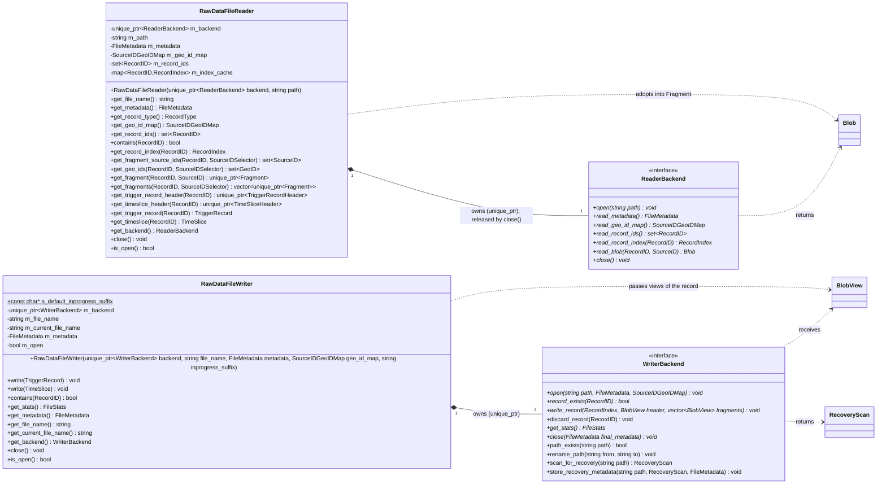

Notes, from `RawDataFileReader.hpp`, `RawDataFileWriter.hpp` and `Backend.hpp`:
- Neither class can be copied or moved: copy and move are deleted. Both are normally created
  through `open_raw_data_file()` / `create_raw_data_file()` and held by `std::unique_ptr`.
- The reader gives up its backend on `close()`: it moves `m_backend` out, so `is_open()` becomes
  `m_backend != nullptr`, which is false. The writer keeps its backend after close, and
  `is_open()` is `m_backend != nullptr && m_open`.
- `get_metadata()` on the writer returns the metadata as given at creation, with
  `creation_timestamp_ms` filled in. After a successful backend `close()`, it returns the final
  metadata (closing timestamp and stats).
- `get_backend()` throws `FileClosed` once the reader or writer is closed.
- The reader is not thread-safe (class comment): the index cache is a `mutable std::map`.

The virtual members of the backend interfaces and their defaults:

| Interface | Member | Pure? | Default (`src/Backend.cpp`) | Contract (comments in `Backend.hpp`) |
|---|---|---|---|---|
| `ReaderBackend` | `open(path)` | yes | | Called once, on an unopened backend |
| | `read_metadata()`, `read_geo_id_map()`, `read_record_ids()` | yes | | Called once each, by the reader's constructor |
| | `read_record_index(record_id)` | yes | | Called at most once per record (the reader caches the result) |
| | `read_blob(record_id, source_id)` | yes | | The bytes of the record header (when `source_id` is the header's SourceID) or of a fragment |
| | `close()` | yes | | Must release the file even when it throws, and be harmless if `open()` failed or was never called |
| | `~ReaderBackend()` | virtual | `= default` | |
| `WriterBackend` | `open(path, metadata, geo_id_map)` | yes | | Creates a new file. Must fail, leaving any existing file untouched, if `path` exists |
| | `record_exists(record_id)` | yes | | |
| | `write_record(index, header, fragments)` | yes | | Writes one complete record: header bytes, fragment bytes and index. The parts' SourceIDs are all different (the writer checks) |
| | `discard_record(record_id)` | no | throws `std::runtime_error` ("can't remove a partly written record") | Called only after `write_record` threw for this record. Removes whatever of it was stored, so that `record_exists()` is false again and `get_stats()` no longer counts it; the file size may stay |
| | `get_stats() const` | yes | | |
| | `close(final_metadata)` | yes | | Stores the final metadata and closes. Must release the file even when it throws |
| | `path_exists(path) const` | no | `std::filesystem::exists(path)` | Override for storage that isn't files |
| | `rename_path(from, to)` | no | `rename_without_replacing(from, to)` | Must never replace an existing `to`, even one that appears concurrently |
| | `scan_for_recovery(path)` | no | throws `std::runtime_error` ("can't recover unfinished files") | Read-only scan. Must throw if it can't tell which records the file holds |
| | `store_recovery_metadata(path, scan, final_metadata)` | no | throws `std::runtime_error` | Stores only the closing values the scan found missing |
| | `~WriterBackend()` | virtual | `= default` | |

### 4.2 Metadata and value types

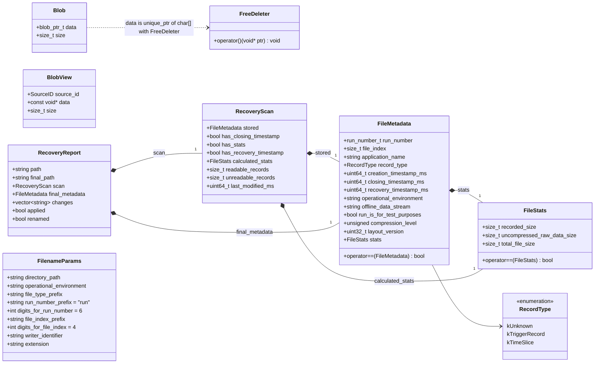

| Type | Header | Points to note |
|---|---|---|
| `RecordType` | `FileMetadata.hpp` | `record_type_to_string()` gives `"TriggerRecord"`, `"TimeSlice"` or `"Unknown"`, the names stored in existing files. `string_to_record_type()` maps any other string to `kUnknown` |
| `FileStats` | `FileMetadata.hpp` | `recorded_size` counts bytes as stored (after compression). `uncompressed_raw_data_size` counts bytes before compression. `total_file_size` is the whole file, including format overhead. Defaulted `==` |
| `FileMetadata` | `FileMetadata.hpp` | Writers receive it at creation; `closing_timestamp_ms` and `stats` are filled in at close. A `creation_timestamp_ms` of 0 is replaced by "now". `recovery_timestamp_ms` is 0 unless the file was recovered. `layout_version` is format-specific (0 if not applicable). Defaulted `==` |
| `Blob` | `Backend.hpp` | `data` is a `blob_ptr_t` = `std::unique_ptr<char[], FreeDeleter>`. Create one with `allocate_blob(size)`, which throws `std::bad_alloc` on failure |
| `BlobView` | `Backend.hpp` | Non-owning view of bytes to write, with their SourceID. Valid only during the `write_record` call |
| `RecoveryScan` | `Backend.hpp` | One `FileMetadata stored` (closing values 0 where missing), one `FileStats calculated_stats` |
| `RecoveryReport` | `Recovery.hpp` | One `RecoveryScan`, one `FileMetadata final_metadata`, the list of changes |
| `FilenameParams` | `FileUtils.hpp` | The fields of appmodel `FilenameParams` plus context. `extension` has no leading `.` |

### 4.3 Plugin factory and the in-memory test double

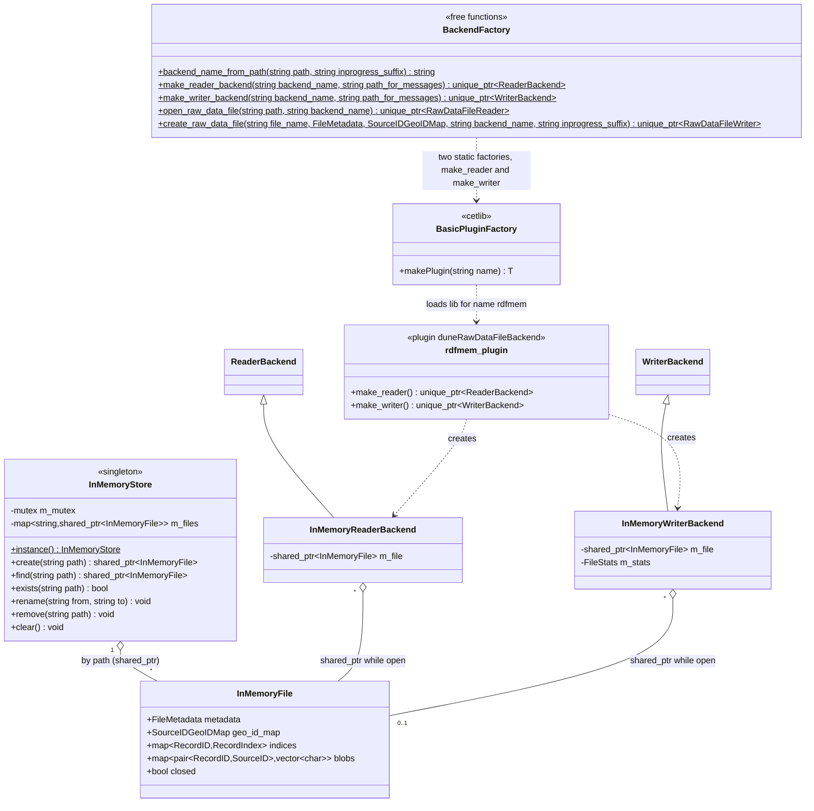

- `src/BackendFactory.cpp` keeps two function-local static `cet::BasicPluginFactory` objects, both
  of plugin type `"duneRawDataFileBackend"`. One looks up the symbol `"make_reader"` and the other
  `"make_writer"`. `make_*_backend("")` and a null result both give `BackendNotAvailable`. A
  `cet::exception` from the factory is chained into `BackendNotAvailable`.
- `open_raw_data_file()` / `create_raw_data_file()` take the backend name from the path when
  `backend_name` is empty, then construct the reader or writer. `create_raw_data_file()` takes the
  name from `file_name`, the final name, not the in-progress name.
- The in-memory test double (`InMemoryBackend.hpp`) is not a format: it keeps "files" in a process-wide
  `InMemoryStore`, keyed by path because the generic layer's job is the file lifecycle and a double
  has to answer to paths to exercise it. The map is behind a mutex. Only the map is locked: an `InMemoryFile`'s contents are not.
  - The writer overrides `path_exists` and `rename_path` to act on the store.
    `InMemoryStore::rename` throws if `to` exists.
  - Its stats count every blob's size in all three fields.
  - It implements `discard_record` (erases the record's index and blobs and subtracts their sizes
    from the stats) and both recovery hooks.
  - `InMemoryStore::create` throws `FileOpenFailed` if the path exists.
  - The reader's `open` throws `std::runtime_error` for an unknown path.

### 4.4 The HDF5 backend as subclasses

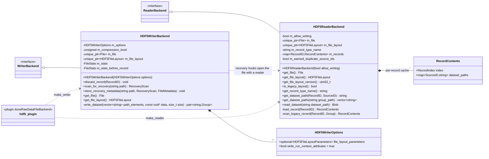

Both classes are in `dunedaq::hdf5libs`. `File` and `Group` are `HighFive::File` and
`HighFive::Group`. They implement every pure virtual of their interface (not repeated in the
diagram). `HDF5WriterBackend` keeps the filesystem defaults of `path_exists` and `rename_path`, and
overrides `discard_record` and both recovery hooks (`hdf5libs:include/hdf5libs/HDF5Backend.hpp`). Details are in §11.

### 4.5 Record-model types used

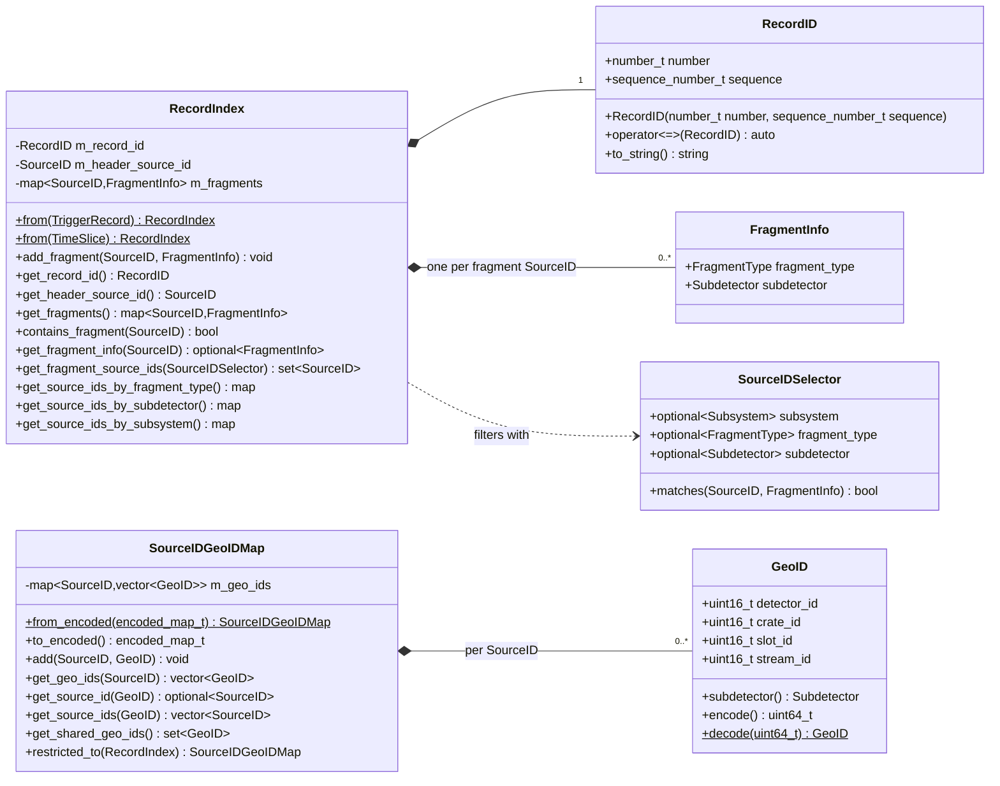

How rawdatafilelibs uses them (`daqdataformats:include/daqdataformats/RecordIndex.hpp`,
`SourceIDGeoIDMap.hpp`, `RecordID.hpp`, `detdataformats:include/detdataformats/GeoID.hpp`):
- **`RecordID`** is (number, sequence). `number` is `uint64_t`, and holds a trigger number or a
  timeslice number. It is ordered with `<=>`, and is the key everywhere: the reader's
  `set<RecordID>`, the index cache, and the backend calls. TimeSlices use sequence 0
  (`RecordIndex::from(TimeSlice)`).
- **`RecordIndex::from(record)`** takes the header's element ID as the header SourceID. For each
  fragment it records `get_element_id()` with its fragment type and its detector ID as subdetector.
  The fragments are a `std::map<SourceID, FragmentInfo>`, so one SourceID has one entry.
- **`SourceIDSelector`** has three optional criteria (subsystem, fragment type, subdetector),
  combined with AND. An empty selector matches everything. All of the reader's selector parameters
  default to `{}`.
- **`SourceIDGeoIDMap`** is stored once per file and read once at open. The reader's
  `get_geo_ids(record, selector)` returns the GeoIDs of the selected fragments that are actually
  present in the record (`src/RawDataFileReader.cpp`). `add()` refuses to give a GeoID to a second
  SourceID (`std::invalid_argument`), but a stored map read with `from_encoded()` may break that
  rule. In that case the reader logs `SharedGeoIDs` at open, and `get_source_id()` gives `nullopt`
  for those GeoIDs.
- **`GeoID`** packs four 16-bit fields into a `uint64_t` (detector in bits 0-15, crate 16-31,
  slot 32-47, stream 48-63). This is the canonical encoding used in the stored map.

---

## 5. Reading

### 5.1 Opening a file and reading a fragment

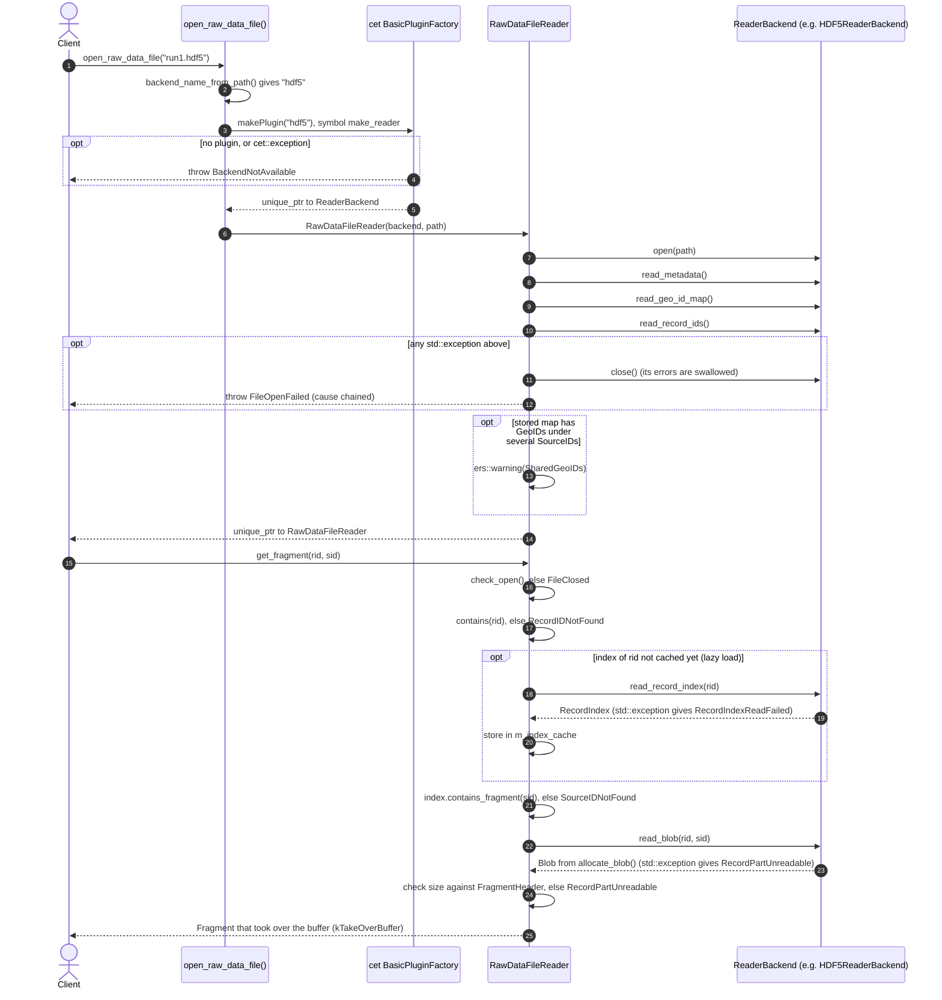

The record IDs, metadata and GeoID map are read eagerly in the constructor. Record indices are
read lazily, one record at a time, on the first call that needs them, and are cached until
`close()` (`m_index_cache`). Fragment bytes are never cached: every `get_fragment` calls
`read_blob` again.

### 5.2 Reader operations

| Method | Behaviour (`src/RawDataFileReader.cpp`) |
|---|---|
| `get_record_ids()`, `contains()` | From the set read at open. Still usable after `close()` |
| `get_record_index(rid)` | `FileClosed` if closed. `RecordIDNotFound` if `rid` is not in the set. Loads and caches the index otherwise. A backend failure gives `RecordIndexReadFailed` |
| `get_fragment_source_ids(rid, sel)` | `get_record_index(rid).get_fragment_source_ids(sel)`. The record header's SourceID is never included |
| `get_geo_ids(rid, sel)` | For each selected SourceID of the record, its GeoIDs from the file's map, as a set |
| `get_fragment(rid, sid)` | See 5.1. The stored data must be at least `sizeof(FragmentHeader)`. The header's `size` must not exceed the data and must not be smaller than `sizeof(FragmentHeader)`. Otherwise `RecordPartUnreadable` |
| `get_fragments(rid, sel)` | `get_fragment` for each selected SourceID, in SourceID order |
| `get_trigger_record_header(rid)` | First `RecordTypeMismatch` if the file's type is `kTimeSlice`. Reads the blob of the index's header SourceID, and checks that it holds a `TriggerRecordHeaderData` and all the `ComponentRequest`s that it claims, else `RecordPartUnreadable`. Then copies it into a new `TriggerRecordHeader` (`TriggerRecordHeader(buffer, true)`), and the buffer is freed |
| `get_timeslice_header(rid)` | First `RecordTypeMismatch` if the file's type is `kTriggerRecord`. The blob must be at least `sizeof(TimeSliceHeader)`, else `RecordPartUnreadable`. Copies it with `memcpy` |
| `get_trigger_record(rid)` / `get_timeslice(rid)` | Header as above, plus all fragments of the record, moved into the record |
| `close()` | No-op if already closed. Moves the backend out (so it is released even if closing throws), clears the cache, calls `backend->close()`, and turns any exception, `std::exception` or not, into `FileCloseFailed` |
| `~RawDataFileReader()` | Calls `close()`. `ers::Issue` is logged with `ers::error`. Other exceptions are logged as `FileCloseFailed`. Never throws |

Record-type checks give files that don't say what they hold the benefit of the doubt: a
`kUnknown` file passes both header checks (`check_record_type`).

After `close()`, only `get_file_name()`, `get_metadata()`, `get_geo_id_map()` and `get_record_ids()` may
be used (header comment). `contains()` also still works, because it only reads the set. Everything
that reads data goes through `get_record_index()` and throws `FileClosed`.

---

## 6. Writing and the file lifecycle

### 6.1 Writing a file through close

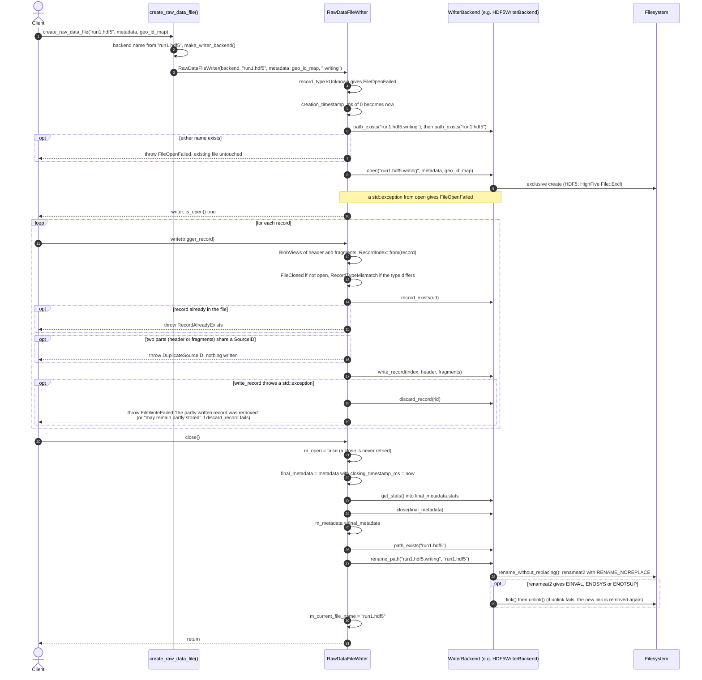

Points of detail (`src/RawDataFileWriter.cpp`):
- `write(TriggerRecord)` gives the backend
  `BlobView{header.get_element_id(), header.get_storage_location(), header.get_total_size_bytes()}`
  and, for each fragment, `{get_element_id(), get_storage_location(), get_size()}`.
  `write(TimeSlice)` copies the `TimeSliceHeader` to a local variable and passes a view of it of
  `sizeof(TimeSliceHeader)` bytes. No record bytes are copied by the generic layer.
- The checks run in this order: open, record type, record already present
  (`backend->record_exists`), SourceIDs (the header's and every fragment's must all differ, else
  `DuplicateSourceID`), and then the write. Only the `write_record` call is wrapped into
  `FileWriteFailed`.
- When `write_record` throws a `std::exception`, the writer calls `backend->discard_record(rid)`
  before throwing `FileWriteFailed`. Its message says either "the partly written record was
  removed" (the record can then be written again) or "the record may remain partly stored (...)"
  when `discard_record` throws, as the default does. A non-standard exception from `write_record`
  is not caught (§15).
- `get_stats()` returns the backend's live stats while open, and `m_metadata.stats` once closed.
- With an empty in-progress suffix, the current and final names are the same, and `close()` does
  not rename. The Python test `test_close_failure_does_not_hide_the_with_block_exception` uses
  that to create a file directly under its final name.

### 6.2 A failed close

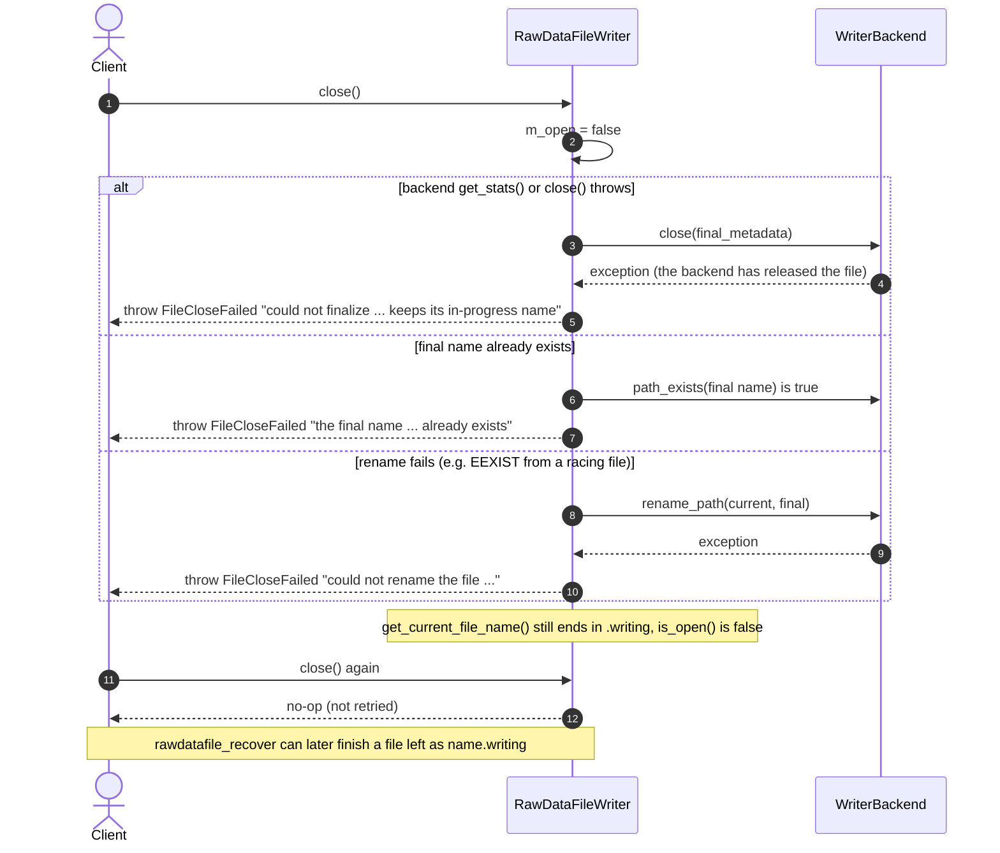

The two "final name" cases differ only in their message. The `path_exists` check is there for a
clearer error, and `rename_path` itself never replaces a file. A non-`std::exception` thrown by
the backend's `close()` or `rename_path()` also becomes `FileCloseFailed` (test
`NonStandardCloseExceptionsAreContained`). The destructor calls `close()` and logs any failure
with `ers::error`. A writer that was never closed explicitly is finalized in its destructor, and
any failure is only logged.

### 6.3 Writer lifecycle state diagram

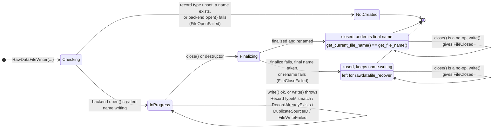

`Finalizing` is not a stored state. `close()` sets `m_open = false` before calling the backend,
so from the outside the writer goes straight from open to one of the two closed states. A
`FileWriteFailed` does not close the file. The failed record is removed again if the backend
supports `discard_record`, and may remain partly stored if it doesn't.

---

## 7. Recovery of unfinished files

`recover_raw_data_file(path, apply, backend_name = "", inprogress_suffix = ".writing")`
(`include/rawdatafilelibs/Recovery.hpp`, `src/Recovery.cpp`) finishes a file that a crashed or
failed writer left behind. It works for any format whose `WriterBackend` implements the two
recovery hooks. The app `rawdatafile_recover [--apply] [--backend <name>] <file>` is a thin wrapper
around it (`apps/rawdatafile_recover.cxx`). It prints `to_string(report)` and exits with 0 on
success, 1 on a usage error, or 2 when anything is thrown: an `ers::Issue` is logged with
`ers::error`, any other exception is printed to standard error.

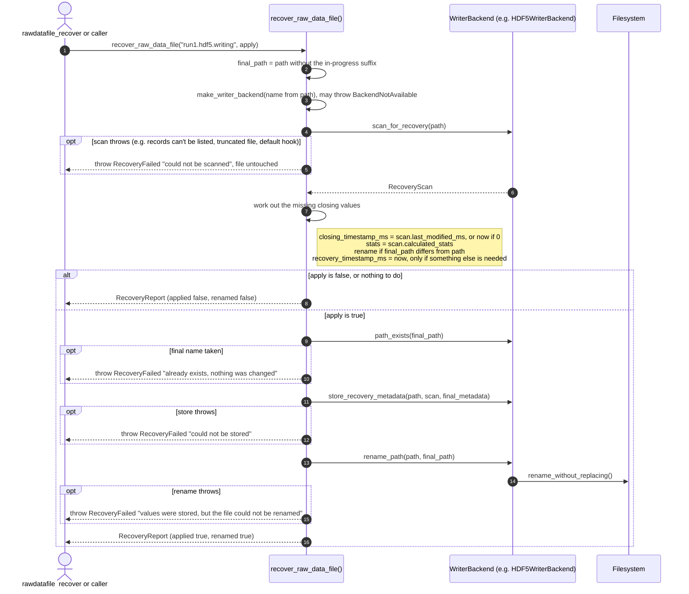

Rules, as implemented:
- **Values already stored are never changed.** The final metadata starts as `scan.stored`. Only
  the values whose `has_*` flag is false are filled in, and `store_recovery_metadata` must store
  only those.
- **A complete file under its final name needs nothing.** No recovery timestamp is set, and
  `changes` is empty, even with `apply`. A complete file that still has its in-progress name gets
  a recovery timestamp and a rename.
- **Dry run versus apply.** Without `apply`, nothing is touched, and `changes` lists what would be
  done, one line per value, with the rename last. `to_string()` prints "Would do (run with --apply
  to do it):" or "Done:", followed by the list. With `apply`, `applied` is set once the values are
  stored, and `renamed` once the rename succeeds.
- **Fail closed.** The scan must throw if it can't tell which records the file holds, rather than
  report an empty file (`Backend.hpp` comment on `scan_for_recovery`). That failure becomes
  `RecoveryFailed`, and the file is untouched. The HDF5 test `TruncatedFileIsNotRecovered` checks
  this. A taken final name is detected before anything is stored.
- **Unreadable parts.** A record with any part (header or fragment) that can't be read counts in
  `unreadable_records`, and its unreadable parts are left out of `calculated_stats`. `to_string()`
  reports "N with unreadable parts (not counted in the recalculated stats)".
- **Stats in the format's own terms.** `calculated_stats` is computed by the backend, because only
  the backend knows, for example, the compressed storage size. For HDF5, `recorded_size` is each
  readable dataset's storage size, `uncompressed_raw_data_size` the element (byte) counts, and
  `total_file_size` the file size now.
- Failures of `make_writer_backend` give `BackendNotAvailable`, not `RecoveryFailed`. It is also an
  ERS issue, so the app reports it with exit code 2.

---

## 8. Error model

All issues are declared in `include/rawdatafilelibs/Issues.hpp`, in namespace
`dunedaq::rawdatafilelibs`. They are ordinary `ers::Issue`s (hence `std::exception`s). Where the
generic layer wraps a backend exception, the backend's exception is chained as the cause. In
Python they arrive as `RuntimeError` (the tests match on `RuntimeError`).

| Issue | Parameters | Thrown when | Where |
|---|---|---|---|
| `FileOpenFailed` | file, message | Reader: no backend given, or the backend's `open`/`read_metadata`/`read_geo_id_map`/`read_record_ids` throws. Writer: no backend given, record type `kUnknown`, the in-progress or final name already exists, or the backend's `open` throws. Also thrown by `InMemoryStore::create` for an existing path | `RawDataFileReader.cpp`, `RawDataFileWriter.cpp`, `InMemoryBackend.cpp` |
| `FileCloseFailed` | file, message | Reader `close()`: the backend's `close()` throws anything. Writer `close()`: `get_stats()`/`close()` throws, the final name exists, or `rename_path` throws. Also logged (not thrown) by destructors for non-ERS exceptions | `RawDataFileReader.cpp`, `RawDataFileWriter.cpp` |
| `FileWriteFailed` | record_id, file, message | Backend `write_record` throws a `std::exception`. The writer has then called `discard_record`; the message says "the partly written record was removed" or "the record may remain partly stored (...)" | `RawDataFileWriter.cpp` |
| `FileClosed` | file | Reader: any data access after `close()` (`get_record_index`, and everything built on it, plus `get_backend`). Writer: `write()`, `record_exists()` or `get_backend()` after `close()` | both |
| `RecordIDNotFound` | record_id, file | Reader: the record is not in the file | `RawDataFileReader.cpp` |
| `SourceIDNotFound` | source_id, record_id, file | Reader `get_fragment`: the SourceID is not in the record's index | `RawDataFileReader.cpp` |
| `RecordIndexReadFailed` | record_id, file, message | Reader: the backend's `read_record_index` throws | `RawDataFileReader.cpp` |
| `RecordPartUnreadable` | source_id, record_id, file, message | Reader: the SourceID is listed in the index (or is the header's) but `read_blob` throws, or the stored bytes are too short or inconsistent for a Fragment, TriggerRecordHeader or TimeSliceHeader | `RawDataFileReader.cpp` |
| `RecordAlreadyExists` | record_id, file | Writer: `backend->record_exists(rid)` is true | `RawDataFileWriter.cpp` |
| `DuplicateSourceID` | source_id, record_id, file | Writer: two parts of the record (the header and the fragments) have the same SourceID. Checked before the backend is called, so nothing of the record is written | `RawDataFileWriter.cpp` |
| `RecordTypeMismatch` | file, file_type, requested_type | Writer: writing a TimeSlice to a TriggerRecord file or vice versa. Reader: asking a typed file for the other kind of header or record | both |
| `BackendNotAvailable` | backend, file | `make_reader_backend`/`make_writer_backend`: empty name, cetlib can't load the plugin (cause chained), or the plugin returns null. The message names `CET_PLUGIN_PATH` and asks whether the providing package is set up | `BackendFactory.cpp` |
| `RecoveryFailed` | file, message | `recover_raw_data_file`: scan fails, final name taken, storing fails, or the rename fails | `Recovery.cpp` |
| `SharedGeoIDs` | file, count, example | Warning only (`ers::warning`), at reader construction, when the stored map lists a GeoID under more than one SourceID | `RawDataFileReader.cpp` |

**Exception guarantees**
- **Destructors never throw.** `~RawDataFileReader` and `~RawDataFileWriter` call `close()`, and
  catch `ers::Issue`, `std::exception` and `...`, logging each with `ers::error`.
- **`close()` contains everything.** Both `close()`s catch `std::exception` and `...` from the
  backend and throw `FileCloseFailed`, so a backend that throws, for example, an `int` cannot
  escape as such.
- **A close is reported once and never retried.**
  - The writer sets `m_open = false` before doing any work.
  - The reader moves its backend out before calling `close()` on it.
  - A second `close()` is a no-op in both.
  - `FileDataStore::close_file_if_open()` likewise moves the writer out first (§12).
- **Backends must release their file even when `close()` throws** (`Backend.hpp`). Both HDF5
  backends move their `HighFive::File` into a local before flushing, so it is destroyed on every
  path.
- **The writer's file name tells the truth.** After a failed close, `get_current_file_name()` is
  still the in-progress name. It changes to the final name only after a successful rename.
- **A failed constructor leaves existing files alone.** The existence checks run before the
  backend's `open`, and the backend's `open` must fail on an existing path.
- **A failed write is undone where the backend can.** After `write_record` throws, the writer
  calls `discard_record`; `FileWriteFailed` says whether the record was removed.
- **Scope of the wrapping.** Constructors and `write()` wrap only `std::exception` from the backend.
  Only the `close()` paths and the destructors also catch non-standard exceptions.

---

## 9. File utilities

`include/rawdatafilelibs/FileUtils.hpp`, `src/FileUtils.cpp`:

| Function | Behaviour |
|---|---|
| `make_file_name(params, run_number, file_index)` | `"<dir>/<openv>_<type>_<runprefix><run>_<indexprefix><index>_<writer>.<extension>"`. The run number is zero-padded to `digits_for_run_number`, and the index to `digits_for_file_index`. `"<dir>/"` is left out when `directory_path` is empty. Example (test `FileNameMatchesDAQConvention`): `/data/np04hd_raw_run012345_0007_dataflow0_datawriter_0.hdf5` |
| `make_timestamp_string(time)` | UTC as `YYYYMMDDTHHMMSS` (`gmtime_r` + `put_time("%Y%m%dT%H%M%S")`) |
| `add_timestamp_suffix(file_name, extension, time)` | Inserts `"_" + make_timestamp_string(time)` before `".<extension>"`. Names with nothing before the extension are returned unchanged. It does not check that the name actually ends in that extension. Example: `/data/run1_0000_app.hdf5` becomes `/data/run1_0000_app_20251023T131500.hdf5` |
| `get_free_space(path)` | `statvfs`: `f_bsize * f_bavail` (bytes available to unprivileged users), or `std::nullopt` if `statvfs` fails |
| `current_time_ms()` | Milliseconds since the epoch from `std::chrono::system_clock`, as stored in `FileMetadata` timestamps |
| `rename_without_replacing(from, to)` | `renameat2(AT_FDCWD, from, AT_FDCWD, to, RENAME_NOREPLACE)`. If that fails with `EINVAL`, `ENOSYS` or `ENOTSUP` (no `RENAME_NOREPLACE` support, e.g. NFS), it falls back to `link(from, to)` + `unlink(from)`, since `link` also refuses an existing target. Throws `std::system_error` with the errno (`EEXIST` if `to` exists). On failure the file keeps its old name. If `unlink(from)` fails after a successful `link`, the new name is removed again and the error says "the old name could not be removed"; only if that removal fails too is the file left under both names, and the error says so |

These are the format-independent pieces of the old dfmodules `FileDataStoreImpl`, now used by
`FileDataStore` (§12). `rename_without_replacing` is also the default
`WriterBackend::rename_path`, and hdf5libs' `rename_without_replacing` forwards to it.

---

## 10. Python API

The Python package `rawdatafilelibs` (`python/rawdatafilelibs/__init__.py`) has two layers. It
imports `detdataformats` and `daqdataformats` first, because their types appear in the bindings.

### 10.1 The C++-mirror bindings

Module `_daq_rawdatafilelibs_py` (`pybindsrc/`). Everything in it is re-exported by
`rawdatafilelibs` with the C++ names and arguments:

| Area | Bound names (file) |
|---|---|
| Metadata (`file_metadata.cpp`) | `RecordType` (`kUnknown`, `kTriggerRecord`, `kTimeSlice`), `record_type_to_string`, `string_to_record_type`, `FileStats`, `FileMetadata` (all fields read-write, `==`, `__repr__`) |
| Reader and writer (`raw_data_file.cpp`) | `ReaderBackend`, `WriterBackend` (base classes only, so that format modules can bind subclasses), `RawDataFileReader`, `RawDataFileWriter` (with the static property `s_default_inprogress_suffix`), `backend_name_from_path`, `open_raw_data_file(path, backend_name="")`, `create_raw_data_file(file_name, metadata, geo_id_map=SourceIDGeoIDMap(), backend_name="", inprogress_suffix=".writing")` |
| In-memory store (`raw_data_file.cpp`) | `in_memory_file_exists(path)`, `remove_in_memory_file(path)`, `clear_in_memory_files()` |
| File utilities (`file_utils.cpp`) | `FilenameParams`, `make_file_name`, `make_timestamp_string(seconds_since_epoch)`, `add_timestamp_suffix(file_name, extension, seconds_since_epoch)`, `get_free_space` (`None` on failure) |
| Recovery (`recovery.cpp`) | `RecoveryScan`, `RecoveryReport` (read-only fields, `str()` = `to_string`), `recover_raw_data_file(path, apply=False, backend_name="", inprogress_suffix=".writing")` |

Binding choices:
- **Copies, not references.** `get_metadata`, `get_geo_id_map`, `get_record_ids` and `get_record_index`
  return copies (`return_value_policy::copy`), so they stay valid after `close()`. This matters for
  `get_record_index`, whose C++ reference points into the cache that `close()` clears.
- **Backend extras.** `get_backend()` uses `reference_internal`, so the backend keeps its reader or
  writer alive. Because the base classes are bound, pybind11 returns the most derived type
  registered. With `import hdf5libs` (whose `__init__` imports rawdatafilelibs first), an HDF5
  file's backend is an `hdf5libs.HDF5ReaderBackend`.
- **Context managers.** `RawDataFileReader` and `RawDataFileWriter` implement `__enter__` and
  `__exit__`. With no exception in the block, `__exit__` closes the file and a close failure is
  raised. If the block raised, the close failure is attached to the block's exception with
  `add_note("closing the file also failed: ...")`, and the block's exception propagates
  (`close_on_exit` in `raw_data_file.cpp`).
- Not bound: `rename_without_replacing`, `make_reader_backend`/`make_writer_backend`, `Blob`,
  `BlobView`, and `InMemoryStore` itself (only the three helpers above).

### 10.2 The Pythonic layer

`python/rawdatafilelibs/rawdatafile.py` provides:

| Name | What it is |
|---|---|
| `open(path, backend="")` | Returns a `RawDataFile`. Not exported by `from rawdatafilelibs import *`, so that it doesn't shadow the builtin `open` (test `test_star_import_does_not_shadow_open`) |
| `create(path, record_type, geo_id_map=None, backend="", inprogress_suffix=None, **metadata)` | Returns the C++-mirror `RawDataFileWriter`, which is a context manager. `record_type` is `"TriggerRecord"`, `"TimeSlice"` or a `RecordType`. Keywords set other `FileMetadata` fields. Unknown fields, and `stats`, `closing_timestamp_ms` and `layout_version`, give `TypeError`. Also not exported by `*` |
| `RawDataFile` | A file open for reading. Wraps a `RawDataFileReader` (attribute `reader`). Properties: `path`, `metadata`, `record_type` (a string), `geo_id_map`, `backend`, `record_ids` (sorted list). `len()`, `in`, iteration in record order, `records()`, and `f[rid]`, where `rid` is a `RecordID`, an `int` (sequence 0) or a `(number, sequence)` pair. A missing record gives `KeyError`. It is a context manager with the same add-note rule as above |
| `Record` | One record, read lazily. On construction it holds only its index (`reader.get_record_index`). Attributes and properties: `id`, `index`, `number`, `sequence`, `header_source_id`, `header` (TimeSliceHeader for `"TimeSlice"` files, else TriggerRecordHeader). Methods: `source_ids(...)`, `geo_ids(...)` (both sorted), `fragment(source_id)`, `fragments(...)` (a generator in SourceID order), `assemble()` (the whole TriggerRecord or TimeSlice). `iter()` gives the fragments, and `len()` the number of fragments |
| `make_selector(subsystem=None, fragment_type=None, subdetector=None)` | A `daqdataformats.SourceIDSelector`. Each criterion may be an enum value or its name, e.g. `"Detector_Readout"`, `"WIBEth"`, `"HD_TPC"`. Unknown names give `ValueError` |
| `as_record_id(x)` | A `RecordID` from a `RecordID`, an `int` or a 2-sequence. Anything else gives `TypeError` |

Example, from the module docstring and `hdf5libs:test/python/test_python_api.py`:

```python
import rawdatafilelibs

with rawdatafilelibs.open("run001234_0000_dataflow0.hdf5") as f:
    print(f.metadata.run_number, f.record_type, len(f))
    for record in f:                                   # records in order
        print(record.id, record.header.get_trigger_timestamp())
        for frag in record.fragments(subdetector="HD_TPC", fragment_type="WIBEth"):
            ...
    record = f[(17, 0)]                                # or f[17], or f[RecordID(17, 0)]

# copy a filtered set of records to a new file (test_copy_records_to_new_files)
with rawdatafilelibs.open(path) as source:
    with rawdatafilelibs.create("copy.hdf5", "TriggerRecord", geo_id_map=source.geo_id_map,
                                run_number=source.metadata.run_number) as writer:
        for record in source:
            if record.number % 2 == 1:
                writer.write(record.assemble())
```

The C++-mirror layer, from `test/python/test_rawdatafilelibs.py`:

```python
reader = rawdatafilelibs.open_raw_data_file("empty.rdfmem")
assert reader.get_metadata().run_number == 77
assert reader.get_record_ids() == set()
reader.close()

report = rawdatafilelibs.recover_raw_data_file(str(unfinished))              # dry run
report = rawdatafilelibs.recover_raw_data_file(str(unfinished), apply=True)
print(report)                                                                 # to_string(report)
```

### 10.3 Compatibility names (from `hdf5libs.HDF5RawDataFile`)

`RawDataFile` also has the Python method names of `hdf5libs.HDF5RawDataFile`, so scripts can move
one call at a time. These methods accept record IDs as `(number, sequence)` pairs, numbers or
`RecordID`s, and return record IDs as `(number, sequence)` pairs, as `HDF5RawDataFile` did. The
dataset-path functions are not provided. They are HDF5-only, and are available on `f.backend`
(§11.3).

| Status | Methods |
|---|---|
| **Supported** | `get_file_name`, `get_record_type`, `is_trigger_record_type`, `is_timeslice_type`, `get_recorded_size`, `get_all_record_ids` (sorted list of pairs), `get_record_header_source_id`, `get_fragment_source_ids` (set, no header), `get_source_ids_for_fragment_type`, `get_source_ids_for_subdetector`, `get_geo_ids` (set of encoded GeoIDs), `get_geo_ids_for_subdetector`, `get_frag(record, source_id)`, `get_trh`, `get_tsh`, `get_trigger_record`, `get_timeslice` |
| **Deprecated** (`DeprecationWarning`: "rawdatafilelibs RawDataFile.X is deprecated; use Y") | `get_all_trigger_record_ids`, `get_all_timeslice_ids` (use `get_all_record_ids()` or `record_ids`. Both raise `TypeError` for a file of the other type), `get_source_ids` (includes the header's SourceID; use `get_fragment_source_ids()`), `get_source_ids_for_fragtype_and_subdetector` (use `record.source_ids(fragment_type=..., subdetector=...)`), `get_frag(record, geo_id)` with an `int` encoded GeoID (use the GeoID map. For a GeoID under several SourceIDs it takes the first, as `HDF5RawDataFile` did) |

`hdf5libs.HDF5RawDataFile` itself warns that it is deprecated, and points to
`rawdatafilelibs.open()` (`hdf5libs:python/hdf5libs/__init__.py`).

---

## 11. The HDF5 backend (worked example)

hdf5libs implements the interfaces in `hdf5libs:include/hdf5libs/HDF5Backend.hpp` and
`hdf5libs:src/HDF5Backend.cpp`, and registers them in `hdf5libs:plugins/hdf5.cpp`:

```cpp
#include "hdf5libs/HDF5Backend.hpp"

DEFINE_DUNE_RAW_DATA_FILE_BACKEND(dunedaq::hdf5libs::HDF5ReaderBackend, dunedaq::hdf5libs::HDF5WriterBackend)
```

and in `hdf5libs:CMakeLists.txt`: `daq_add_plugin(hdf5 duneRawDataFileBackend LINK_LIBRARIES hdf5libs)`.
The on-disk layout is unchanged: file layout version 7 (`HDF5FileLayout::s_current_version`), with
the same attribute names, types and order as `HDF5RawDataFile` wrote.

### 11.1 Writer

| Interface member | HDF5 implementation |
|---|---|
| `open` | Takes the layout parameters from `HDF5WriterOptions`, or `default_file_layout_parameters(record_type)` (`"TimeSlice"` prefix, no sequence digits and a `"TimeSliceHeader"` dataset for TimeSlices). A prefix that isn't the record type name gives `LayoutDoesNotMatchRecordType`. Creates the file with `HighFive::File::Excl`. Writes `run_number`, `file_index`, `creation_timestamp`, `application_name`, `filelayout_params`, `filelayout_version`, the file-level GeoID map, `record_type` and `compression_level`, plus (if `write_run_context_attributes`) `operational_environment`, `offline_data_stream` and `run_was_for_test_purposes` |
| `record_exists` | The record's top-level group exists |
| `write_record` | One dataset for the header and one per fragment, at paths from the layout (`get_record_header_path_elements`, `get_fragment_path_elements(record_id, source_id, fragment_type)`, with the fragment type taken from the index). Then stores the record-level SourceID-to-path map, fragment-type map and subdetector map, which readers use as the index. Deflate compression if `compression_level > 0`. Flushes after each dataset. Saves `m_stats` first, for `discard_record` |
| `discard_record` | Unlinks the record's top-level group if it exists, and flushes. Restores `recorded_size` and `uncompressed_raw_data_size` from before the record; `total_file_size` becomes the file's size now, since HDF5 doesn't give the space back |
| `get_stats` | `m_stats`: `uncompressed_raw_data_size` sums the bytes given, `recorded_size` sums `getStorageSize()`, and `total_file_size` is `getFileSize()` after the last dataset |
| `close` | Moves the file out, writes `recorded_size`, `uncompressed_raw_data_size`, `total_file_size` and `closing_timestamp` (only if absent), and flushes |
| `path_exists`, `rename_path` | Filesystem defaults |
| `scan_for_recovery` | Opens the file read-only with an `HDF5ReaderBackend`. Sets the `has_*` flags from attribute presence. Lists the records, which throws if that fails (fail closed). For each record, counts the storage size and element count of every dataset that can be read. Sets `total_file_size` to the file size and `last_modified_ms` to `st_mtime * 1000` |
| `store_recovery_metadata` | Opens the file read-write (`HDF5ReaderBackend(true)`). Writes only the missing attributes: stats, `closing_timestamp` (an integer from layout version 6, a decimal string before that) and `file_recovery_timestamp` (`int64_t`) |

### 11.2 Reader

| Interface member | HDF5 implementation |
|---|---|
| `open` | Opens `ReadOnly` (or `ReadWrite` with `allow_writing`). Reads `filelayout_params`/`filelayout_version`, or else logs `MissingFileLayout` (info) and uses version 0. The `record_type` attribute must match the layout's record name prefix for version 2 and later, else `BadRecordType` |
| `read_metadata` | File attributes into `FileMetadata`. Timestamps are read as integers or as decimal strings (before version 6). `file_recovery_timestamp` goes into `recovery_timestamp_ms`. `layout_version` is the layout version |
| `read_geo_id_map` | The file-level map, through `HDF5SourceIDHandler`, then `SourceIDGeoIDMap::from_encoded` |
| `read_record_ids` | Top-level groups named exactly `<prefix><digits>[.<digits>]`. Others are ignored |
| `read_record_index` | Version 3 and later: from the stored record-level maps. A SourceID listed under two fragment types gives `DuplicateSourceIDInRecord` (a warning, once per file), and the type named in its dataset path is kept. Version 2 and earlier (legacy, read-only): scans the record's dataset paths, takes SourceIDs from the paths through the layout, and stores no fragment types or subdetectors. The header gets the default (invalid) SourceID. The header's SourceID is never listed as a fragment |
| `read_blob` | `read_dataset(get_dataset_path(record_id, source_id))` into `allocate_blob` memory |
| `close` | Clears the cache and moves the file out (flushes if writable) |

### 11.3 Expert extras

These are reached through `get_backend()`, never through the generic API:
- **C++:** `get_file()` (the `HighFive::File`), `get_file_layout()`, `get_file_layout_version()`,
  `is_legacy_layout()`, `get_record_type_name()`, `get_dataset_path(rid, sid)`,
  `get_dataset_paths(group)` and `read_dataset(path)` on the reader. `get_file()` and
  `get_file_layout()` on the writer.
- **Python** (`hdf5libs:pybindsrc/hdf5backend.cpp`): `HDF5ReaderBackend` binds
  `get_file_layout_version`, `get_attribute_names`, `has_attribute`, `get_attribute` (str, int or
  float, `KeyError` if absent), `is_legacy_layout`, `get_record_type_name`, `get_dataset_path`,
  `get_dataset_paths` and `read_dataset` (returns `bytes`). `HDF5WriterBackend` binds
  `get_file_layout_version`. The module also has `CURRENT_FILE_LAYOUT_VERSION` and
  `LAST_LEGACY_FILE_LAYOUT_VERSION`.

`hdf5libs::HDF5RawDataFile` is kept as a facade over these classes and will be deprecated later (the
`[[deprecated(...)]]` attribute and the removal are separate steps). Its behaviour differences are
listed in its header comment.

---

## 12. The main writer client: dfmodules FileDataStore

The DataStore side is covered in depth in the FileDataStore design document (in the Drive folder
named at the top). In short,
for rawdatafilelibs (`dfmodules:include/dfmodules/FileDataStore.hpp`,
`dfmodules:src/FileDataStore.cpp`, `dfmodules:plugins/HDF5DataStore.hpp`):
- `FileDataStore` is a non-template `DataStore` base that owns one
  `std::unique_ptr<rawdatafilelibs::RawDataFileWriter>`. It uses `make_file_name()`,
  `add_timestamp_suffix()` and `get_free_space()` from FileUtils, and builds the `FileMetadata` for
  each file.
- A format's DataStore implements two functions:
  `get_file_name_extension()` (`"hdf5"`) and `make_writer_backend(RecordType)`, which returns a
  new, unopened `WriterBackend`. `HDF5DataStore` returns an `HDF5WriterBackend` with the configured
  layout parameters. `FileDataStore` constructs the `RawDataFileWriter` directly with that backend.
  It doesn't use the plugin factory, because the DataStore plugin itself already chooses the
  format.
- The `.writing` name, never-replace, the record-type check and the closing values all come from
  `RawDataFileWriter`.

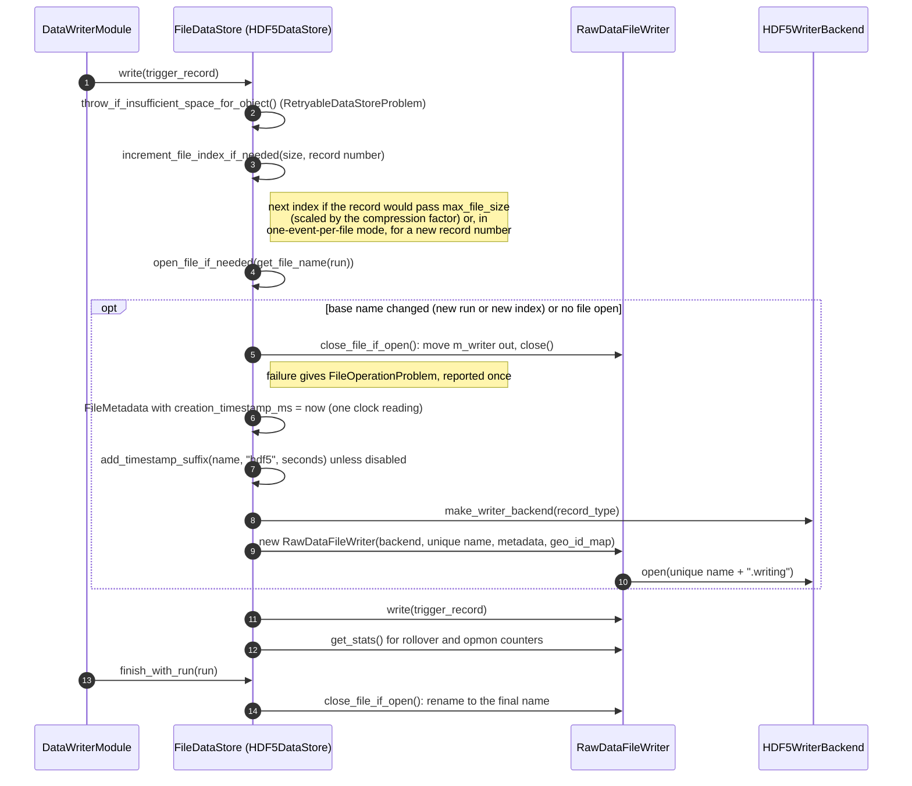

---

## 13. Adding a new format backend

This checklist is derived from the interface contracts in `Backend.hpp` and from what the in-memory
and HDF5 backends do.

### 13.1 Checklist

1. **Pick an extension.** It is the plugin name, and files named `*.<ext>` (also with `.writing`
   and `.copied` after it, in any order) will load your backend. It must not contain a `.`.
2. **Implement `ReaderBackend`:**
   - `open(path)`: open read-only. Throw any `std::exception` on failure (the reader wraps it into
     `FileOpenFailed`).
   - `read_metadata()`: fill every `FileMetadata` field that the file stores. Set `record_type`
     (`kUnknown` is allowed, and passes the reader's type checks). Leave missing closing values at 0.
   - `read_geo_id_map()`: return the map as stored, through `SourceIDGeoIDMap::from_encoded` if you
     store the encoded form.
   - `read_record_ids()`: every record in the file. Be strict about what counts as a record (see
     HDF5's well-formed-name rule).
   - `read_record_index(rid)`: the stored `RecordIndex`. The header SourceID must not also appear as a
     fragment.
   - `read_blob(rid, sid)`: return a `Blob` from `allocate_blob(size)`, never `new[]`. When `sid`
     is the index's header SourceID, return the header bytes. Throw if there is no such data (the
     reader reports `RecordPartUnreadable`).
   - `close()`: release the file even if something throws (move the handle into a local first),
     and be harmless if `open()` failed or was never called.
3. **Implement `WriterBackend`:**
   - `open(path, metadata, geo_id_map)`: create the file exclusively. If `path` exists, fail and
     leave it untouched (the generic check before it is not atomic). Store the metadata known at
     creation and the GeoID map.
   - `record_exists(rid)`: true once any part of the record is stored.
   - `write_record(index, header, fragments)`: store the header bytes under the header SourceID,
     each fragment's bytes under its SourceID, and the index. The SourceIDs are all different (the
     generic writer refuses a record otherwise). The `BlobView`s are only valid during the call.
     Update your stats.
   - `discard_record(rid)` (recommended): called only after your `write_record` threw for that
     record. Remove whatever of it you stored, so that `record_exists(rid)` is false and
     `get_stats()` no longer counts it. Without it, the default throws, the writer reports that the
     record may remain partly stored, and a retry of the record gives `RecordAlreadyExists`.
   - `get_stats() const`: the stats as `close()` should store them, in your format's terms.
   - `close(final_metadata)`: store `closing_timestamp_ms` and `stats` (and anything else that you
     defer), then release the file, even when throwing.
   - `path_exists` / `rename_path`: keep the defaults for files on a filesystem. Override both if
     your storage is not a POSIX file, and make sure that `rename_path` never replaces an existing
     target, even one that appears concurrently.
   - Optional recovery: `scan_for_recovery(path)` (read-only; throw if you can't list the records;
     count only readable parts; fill `last_modified_ms` if known) and
     `store_recovery_metadata(path, scan, final)` (store only what `scan.has_*` says is missing).
     Without them, recovery fails with `RecoveryFailed` from the default `std::runtime_error`.
4. **Register the plugin:** a `plugins/<ext>.cpp` with
   `DEFINE_DUNE_RAW_DATA_FILE_BACKEND(MyReaderBackend, MyWriterBackend)`, and
   `daq_add_plugin(<ext> duneRawDataFileBackend LINK_LIBRARIES <yourlib>)` in CMake. The
   backend classes need a default constructor, since the macro calls `std::make_unique<klass>()`.
   Options can be default arguments, as in `HDF5WriterBackend(HDF5WriterOptions options = {})`.
5. **Python (optional):** in your module, `py::module_::import("rawdatafilelibs._daq_rawdatafilelibs_py")`
   first, then bind your classes as `py::class_<MyReaderBackend, rawdatafilelibs::ReaderBackend>`
   with any extras. Your package's `__init__.py` should `import rawdatafilelibs` first (as
   `hdf5libs` does).
6. **DataStore (if DAQ applications should write the format):** derive from
   `dfmodules::FileDataStore`, implement `get_file_name_extension()` and
   `make_writer_backend(RecordType)`, and put format-specific configuration in an OKS class derived
   from `appmodel::DataStoreConf` (`HDF5DataStoreConf` is the example), as in §12.
7. **Tests:** mirror `unittest/BackendFactory_test.cxx` (round trip through the plugin),
   `RawDataFile_test.cxx` (errors, existing files never reused, malformed data) and
   `Recovery_test.cxx`. Make sure that your plugin target is built before the test (e.g.
   `add_dependencies(<test> <pkg>_<ext>_duneRawDataFileBackend)`).

### 13.2 Minimal skeleton

```cpp
// include/myformat/MyFormatBackend.hpp
#include "rawdatafilelibs/Backend.hpp"

namespace dunedaq::myformat {

class MyReaderBackend : public rawdatafilelibs::ReaderBackend
{
public:
  void open(const std::string& path) override;                 // throw on failure
  rawdatafilelibs::FileMetadata read_metadata() override;
  daqdataformats::SourceIDGeoIDMap read_geo_id_map() override;
  std::set<daqdataformats::RecordID> read_record_ids() override;
  daqdataformats::RecordIndex read_record_index(const daqdataformats::RecordID& record_id) override;
  rawdatafilelibs::Blob read_blob(const daqdataformats::RecordID& record_id,
                                    const daqdataformats::SourceID& source_id) override;
  void close() override;                                       // release even when throwing

private:
  std::unique_ptr<MyFileHandle> m_file;
};

class MyWriterBackend : public rawdatafilelibs::WriterBackend
{
public:
  void open(const std::string& path,                           // exclusive create
            const rawdatafilelibs::FileMetadata& metadata,
            const daqdataformats::SourceIDGeoIDMap& geo_id_map) override;
  bool record_exists(const daqdataformats::RecordID& record_id) override;
  void write_record(const daqdataformats::RecordIndex& index,
                    const rawdatafilelibs::BlobView& header,
                    const std::vector<rawdatafilelibs::BlobView>& fragments) override;
  rawdatafilelibs::FileStats get_stats() const override { return m_stats; }
  void close(const rawdatafilelibs::FileMetadata& final_metadata) override;
  // optional: scan_for_recovery(), store_recovery_metadata()
  // only for non-filesystem storage: path_exists(), rename_path()

private:
  std::unique_ptr<MyFileHandle> m_file;
  rawdatafilelibs::FileStats m_stats;
};

} // namespace dunedaq::myformat
```

```cpp
// src/MyFormatBackend.cpp (selected members)
rawdatafilelibs::Blob
MyReaderBackend::read_blob(const daqdataformats::RecordID& record_id, const daqdataformats::SourceID& source_id)
{
  auto bytes = m_file->find(record_id, source_id);             // throw if absent
  auto buffer = rawdatafilelibs::allocate_blob(bytes.size());
  std::memcpy(buffer.data.get(), bytes.data(), bytes.size());  // or read straight into buffer.data
  return buffer;
}

void
MyReaderBackend::close()
{
  auto file = std::move(m_file);                               // released on every path
  if (file != nullptr) {
    file->finish();
  }
}

void
MyWriterBackend::write_record(const daqdataformats::RecordIndex& index,
                              const rawdatafilelibs::BlobView& header,
                              const std::vector<rawdatafilelibs::BlobView>& fragments)
{
  auto const& record_id = index.get_record_id();
  m_file->store(record_id, header.source_id, header.data, header.size);
  for (auto const& fragment : fragments) {
    m_file->store(record_id, fragment.source_id, fragment.data, fragment.size);
  }
  m_file->store_index(index);
  // update m_stats here
}

void
MyWriterBackend::close(const rawdatafilelibs::FileMetadata& final_metadata)
{
  if (m_file == nullptr) {
    return;
  }
  auto file = std::move(m_file);
  file->store_closing_values(final_metadata.closing_timestamp_ms, final_metadata.stats);
  file->finish();
}
```

```cpp
// plugins/myformat.cpp
#include "myformat/MyFormatBackend.hpp"
DEFINE_DUNE_RAW_DATA_FILE_BACKEND(dunedaq::myformat::MyReaderBackend, dunedaq::myformat::MyWriterBackend)
```

`MyFileHandle` and its methods are placeholders for your format's storage API. Everything else is
the real interface. `InMemoryBackend.cpp` is a complete implementation of this shape in under 300
lines, including recovery.

---

## 14. Testing

### 14.1 rawdatafilelibs C++ unit tests (`unittest/`, 29 cases)

| Module | Cases | What they check |
|---|---|---|
| `RawDataFile_test.cxx` (16, in-memory backend) | `WriteReadTriggerRecords`, `WriteReadTimeSlices` | Round trips. Fragments are byte-identical. TimeSlice header fields. Writing the wrong type to a TimeSlice file |
| | `Metadata` | Creation timestamp filled in. Closing timestamp at or after creation. Stored stats equal `get_stats()`. GeoID map round trip |
| | `SelectionAndGeoIDs` | Subdetector selection. `get_geo_ids` leaves out fragments missing from the record |
| | `StoredMapWithSharedGeoIDIsRead` | A stored map that shares a GeoID opens (with `SharedGeoIDs`). `get_source_id` gives no answer. The record still reads |
| | `LookupErrors` | `RecordIDNotFound`, `SourceIDNotFound`, `RecordTypeMismatch`, `RecordPartUnreadable` (blob removed), `FileOpenFailed` (unknown file), `FileClosed`, a second `close()` |
| | `WriteErrors` | `RecordAlreadyExists`, `RecordTypeMismatch`, `FileClosed` (also from `get_backend()` after close), unset record type gives `FileOpenFailed` |
| | `DuplicateSourceIDsAreRejected` | Two fragments with one SourceID, and a fragment with the header's SourceID: `DuplicateSourceID`, nothing stored, and the record can then be written |
| | `FailedWriteIsRemoved` | A backend that stores part of a record and throws: `FileWriteFailed`, the record is gone, the stats are as before, and the retry gives a complete record |
| | `FailedWriteWithoutDiscardSupport` | The same with the default `discard_record`: the message says "may remain partly stored", and the partial record is still there |
| | `InProgressName` | `.writing` while open, final name after close, idempotent close |
| | `ExistingFilesAreNeverReused` | A stale `.writing` is untouched, an existing final file refuses creation, and a final name appearing before close makes close fail and keeps `.writing`, with no retry |
| | `CloseFailuresKeepTheInProgressName` | Failing finalize and failing rename: `FileCloseFailed` once, not open, `.writing` kept and still readable |
| | `NonStandardCloseExceptionsAreContained` | A backend throwing `int` from `close()`: `FileCloseFailed` from `close()`, and destructors don't throw |
| | `MalformedStoredDataIsRejected` | Truncated fragment, fragment claiming more or less than stored, header claiming too many component requests, truncated header: all `RecordPartUnreadable` |
| | `DefaultRenamePathNeverReplaces` | The default `WriterBackend::rename_path` on real files throws `std::system_error` and leaves both files unchanged |
| `FileUtils_test.cxx` (4) | `FileNameMatchesDAQConvention`, `TimestampSuffix`, `FreeSpace`, `RenameWithoutReplacing` | Name format with and without a directory. Suffix, and a name with nothing before the extension. `nullopt` for a bad path. `EEXIST` with both files intact, then a normal rename, then a missing source. (The `link()` + `unlink()` fallback can't be exercised here: it needs a filesystem without `RENAME_NOREPLACE`) |
| `BackendFactory_test.cxx` (3) | `BackendNameFromPath`, `WriteAndReadThroughPlugin`, `UnknownBackend` | The extension rules (`.writing`, `.copied`, both in either order, hidden files, directories with dots). A round trip through the `rdfmem` plugin loaded by cetlib. `BackendNotAvailable` for an unknown extension, no extension, and an unknown name |
| `Recovery_test.cxx` (6, in-memory backend) | `DryRunChangesNothing`, `ApplyStoresTheMissingValuesAndRenames`, `StoredValuesAreKept`, `TakenFinalNameLeavesTheFileUntouched`, `UnreadablePartsAreReportedAndNotCounted`, `UnknownFileIsAnError` | The full recovery rule set. Recalculated stats equal what a normal close stored. A second recovery has nothing to do |

`BackendFactory_test` and `Recovery_test` depend on the plugin target
(`add_dependencies(... rawdatafilelibs_rdfmem_duneRawDataFileBackend)`). Note that
`dbt-build --unittest` exits 0 even when a case fails, so read the per-case output.

### 14.2 rawdatafilelibs Python tests (`test/python/test_rawdatafilelibs.py`, 9 tests)

They need no recorded data, and use `*.rdfmem` files (the test plugin, on `CET_PLUGIN_PATH` in a work
area) with an autouse fixture that clears the store:
- star-import hygiene (no `open`/`create`);
- metadata and record-type names;
- file utilities and `backend_name_from_path`;
- creating and opening an empty file through both layers;
- existing files never reused (`RuntimeError` "already exists");
- the writer context manager keeping the block's exception and adding the close failure as a note;
- the same for the Pythonic reader;
- bad arguments (`TypeError`, `ValueError`, `RuntimeError` for an unknown file or backend);
- the selector and record-ID helpers.

### 14.3 HDF5 backend tests (hdf5libs, for reference)

`hdf5libs:unittest/HDF5Backend_test.cxx` (17 cases) covers:
- round trips through the `hdf5` plugin;
- the on-disk layout spelled out;
- the facade writing the same layout and keeping its old semantics;
- well-formed record names;
- `DuplicateSourceIDInRecord`, and a fragment type name that ends another type's name (`WIB`,
  `ProtoWIB`);
- a failed write removed by `discard_record`, then retried;
- never reusing a file;
- layout/record-type mismatch;
- recovery (compressed file, dry run, unreadable fragment, truncated file refused);
- string timestamps.

`hdf5libs:test/python/test_python_api.py` (8 tests, needs `HDF5LIBS_TestWriter` on `PATH`) covers:
- Pythonic reading with selections;
- the backend extras;
- the compatibility names against `HDF5RawDataFile`;
- copying filtered records to `.hdf5` and `.rdfmem`;
- the `.writing` name while writing;
- attribute reads;
- recovery;
- the shared-GeoID `get_frag`.

---

## 15. Known limitations and open points

These are points visible in the code at the commits above. There are no `TODO`, `FIXME`, `XXX` or
`REVIEW` markers in rawdatafilelibs. The only one in hdf5libs is a `FIXME` in a test
app (`hdf5libs:test/apps/HDF5LIBS_TestDumpRecord.cpp:242`). Items 3 to 6 are also in the "Known
limitations" list of `docs/README.md`.

**Untested paths**
1. **The legacy HDF5 layout (version 2 and earlier) is untested.** No reference files of those
   versions are available. In those files records are indexed by scanning dataset paths. They have
   no fragment types or subdetectors, so selections by type or subdetector match nothing, and the
   header gets the default SourceID (`HDF5ReaderBackend::scan_legacy_record`).
2. **HDF5 recovery of pre-version-6 files and of real crash files is untested.** That means files
   with string closing timestamps, and files left by a real crash. HDF5 1.10 and later may refuse
   to open such a file until `h5clear -s` is run on it.

**Behaviour of the generic layer**

3. **A rename failure after storing during recovery.** If `rename_path` fails after the values were
   stored (for example, a file appearing at the final name in between), `RecoveryFailed` is thrown
   and the report (with `applied == true`) is not returned. The file keeps its in-progress name
   with the closing values stored; a second recovery then only renames it.
4. **The wrapping is narrower in constructors and `write()`.** The reader and writer constructors
   and `write()` wrap only `std::exception` from the backend. A non-standard exception from a
   backend's `open` or `write_record` propagates unwrapped, and in `write()` the failed record is
   then not discarded. `close()` and the destructors catch everything.
5. **Stats are sampled before the closing values are written.** `close()` takes
   `backend->get_stats()` before `backend->close()`. For HDF5, the stored `total_file_size` is the
   size after the last dataset, without the closing attributes. If the backend's `close()` fails,
   the writer's `get_stats()` afterwards returns the creation-time stats (zeros), because
   `m_metadata` is not updated.
6. **No thread safety.** `RawDataFileReader` is documented as not thread-safe. `InMemoryStore`
   locks its map but not the files in it.

**Python and small issues**

7. **Python can't build records with fragments from scratch.** daqdataformats binds no `Fragment`
   constructor or `TriggerRecord.add_fragment`. Copying and filtering records read from files
   works.
8. **Write performance.** The HDF5 writer flushes after every dataset, as before. Flushing per
   record is an option, but nothing has been measured.
9. **Packaging.** rawdatafilelibs is staged in a private repository. It still has to move to
   DUNE-DAQ and be added to the Spack recipes, `release.yaml` and the release
   `dbt-build-order.cmake` (after daqdataformats, before hdf5libs).

**Fixed since the first review** (rawdatafilelibs `0a0bf65`, hdf5libs `879965f`)
- A failed `write_record` left the record partly stored, so a retry gave `RecordAlreadyExists`:
  now removed through `WriterBackend::discard_record` (§6.1).
- The writer didn't reject duplicate SourceIDs within a record: now `DuplicateSourceID` (§8).
- The `link()` + `unlink()` rename fallback could leave the file under two names: the new link is
  now removed again (§9).
- The writer's `get_backend()` didn't check for a closed file: now `FileClosed`.
- `x.hdf5.writing.copied` gave backend `"writing"`: suffixes are now removed in any order (§2).
- Documentation: a misplaced doc comment in `Backend.hpp`, `BackendNotAvailable` missing from
  `Recovery.hpp`; and `rawdatafile_recover` caught only `ers::Issue` (now everything, §7).
